# FinRisk AI 🧠 — Architecture Document

**S&P Global & CRISIL Campus Hackathon 2026**

---

## Table of Contents

1. [High Level Design (HLD)](#high-level-design-hld)
   - [System Overview](#system-overview)
   - [Layer Architecture](#layer-architecture)
   - [End-to-End Data Flow](#end-to-end-data-flow)
   - [Deployment Topology](#deployment-topology)
2. [Low Level Design (LLD)](#low-level-design-lld)
   - [Module Dependency Graph](#module-dependency-graph)
   - [NLP Pipeline — Class Diagram](#nlp-pipeline--class-diagram)
   - [Risk & Portfolio Engine — Class Diagram](#risk--portfolio-engine--class-diagram)
   - [FastAPI Endpoint Flow](#fastapi-endpoint-flow)
   - [Frontend Component Tree](#frontend-component-tree)
   - [Backtest Engine — Sequence Diagram](#backtest-engine--sequence-diagram)
   - [Optimizer — Decision Flow](#optimizer--decision-flow)
   - [Evidence Gate — State Machine](#evidence-gate--state-machine)

---

## High Level Design (HLD)

### System Overview

FinRisk AI is a **5-layer autonomous platform** that converts raw unstructured financial event streams into risk-bounded, explainable portfolio decisions in near-real time.

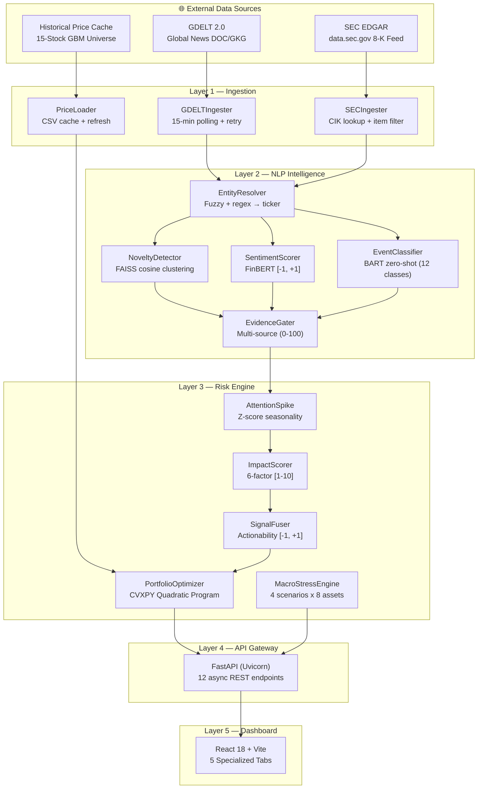

---

### Layer Architecture

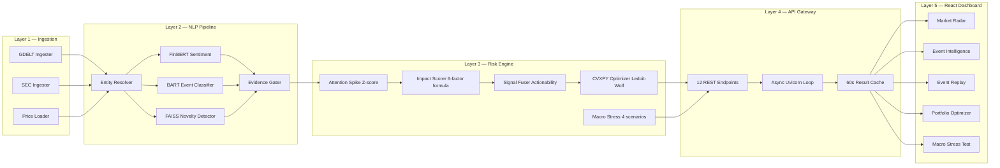

---

### End-to-End Data Flow

```mermaid
sequenceDiagram
    participant GDELT as GDELT API
    participant SEC as SEC EDGAR
    participant ING as Ingestion Layer
    participant NLP as NLP Pipeline
    participant RISK as Risk Engine
    participant OPT as CVXPY Optimizer
    participant API as FastAPI
    participant UI as React Dashboard

    GDELT-->>ING: Raw articles (JSON, every 15 min)
    SEC-->>ING: 8-K filings (CIK lookup)
    ING->>NLP: RawEvent (ticker, headline, source, ts)
    Note over NLP: Entity Resolve → FinBERT → BART → FAISS Novelty → Evidence Gate
    NLP->>RISK: ProcessedSignal (ticker, sentiment, event_type, novelty, evidence, abstain?)
    alt Evidence >= 40 (DEVELOPING / CONFIRMED)
        RISK->>OPT: ActionabilitySignal (ticker, score in [-1,+1])
        OPT->>OPT: Solve QP max(alpha^T w - lambda_risk*w^T*Sigma*w - lambda_turn*norm(delta_w,1))
        OPT->>API: OptimizeResult (weights, trades, turnover)
    else Evidence < 40 (WATCH — Abstain)
        RISK->>API: AbstentionRecord (ticker, evidence, reason)
    end
    API->>UI: JSON response (< 200ms demo / < 2s live)
    UI->>UI: Render portfolio update + toast alert
```

---

### Deployment Topology

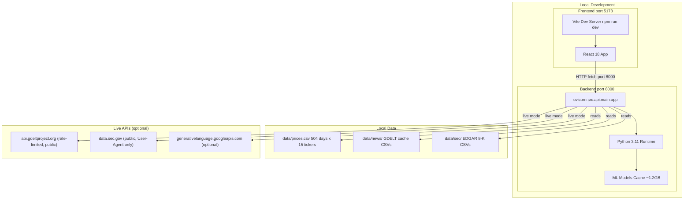

---

## Low Level Design (LLD)

### Module Dependency Graph

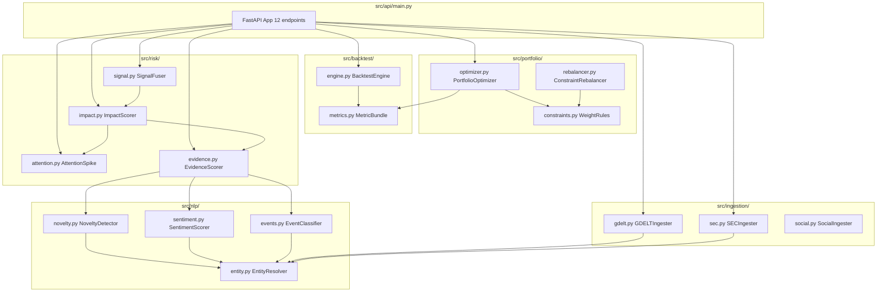

---

### NLP Pipeline — Class Diagram

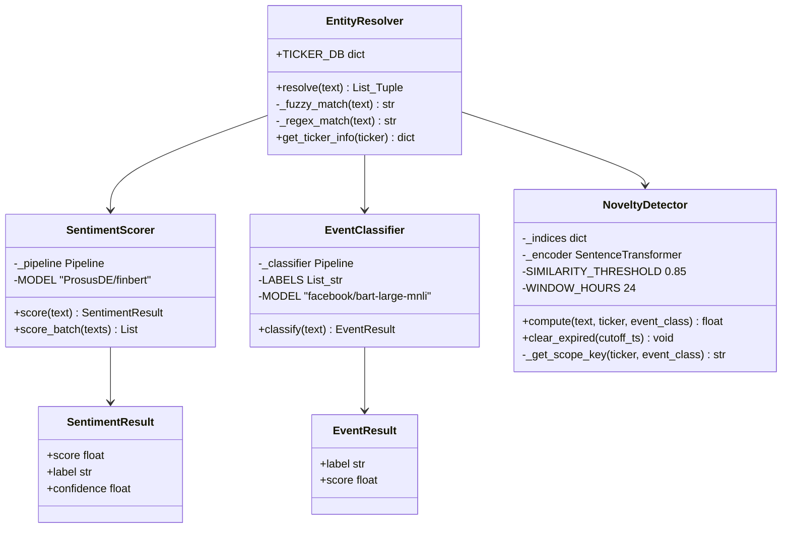

---

### Risk & Portfolio Engine — Class Diagram

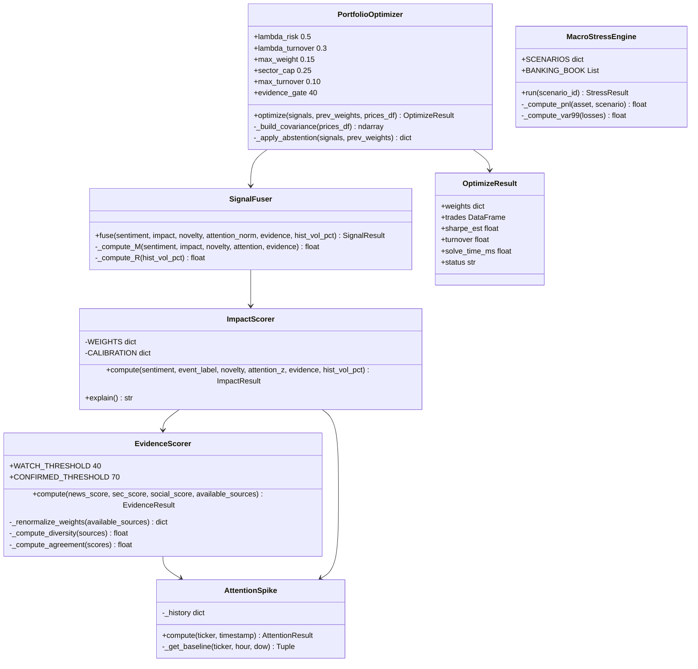

---

### FastAPI Endpoint Flow

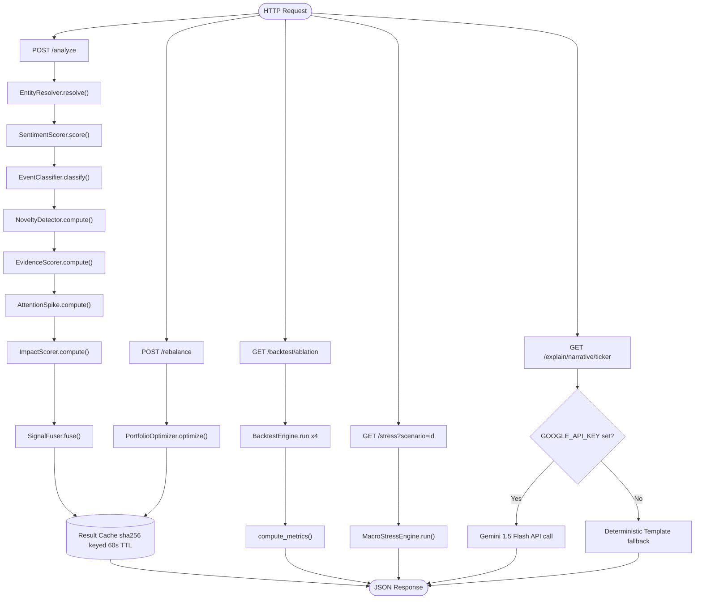

---

### Frontend Component Tree

```mermaid
graph TD
    APP["App.jsx\nstate: mode, toasts, backendHealthy\neffect: healthPoll()"]

    APP --> HDR["Header.jsx Live/Demo toggle Pulse animation"]
    APP --> TOAST["ToastEngine self-contained zero npm deps"]

    APP --> TAB1["MarketRadar.jsx"]
    APP --> TAB2["EventIntelligence.jsx"]
    APP --> TAB3["EventReplay.jsx"]
    APP --> TAB4["Portfolio.jsx"]
    APP --> TAB5["MacroStressTest.jsx"]

    TAB1 --> HM["StockHeatmap 15 tickers x actionability"]
    TAB1 --> RI["RiskIndexChart intraday timeline"]
    TAB1 --> SB["SectorBreakdown BarChart"]

    TAB2 --> EF["EventFeed Filterable list evidence cards"]
    TAB2 --> SC["SignalCard abstention banner evidence bars"]

    TAB3 --> RP["ReplaySlider 3 scenarios step-by-step"]
    TAB3 --> EV2["EvidenceEvolution LineChart"]

    TAB4 --> WD["WeightDeltaBars BUY/SELL badges"]
    TAB4 --> AB["AblationChart 4 equity curves"]
    TAB4 --> NM["NarrativeModal LLM 2-bullet popup"]
    TAB4 --> AJ["AuditJSONExport Client-side download"]

    TAB5 --> SC2["ScenarioSelector 4 pill buttons"]
    TAB5 --> BC["BeforeAfterBarChart GroupedBar"]
    TAB5 --> WF["PnLWaterfall horizontal per asset"]
```

---

### Backtest Engine — Sequence Diagram

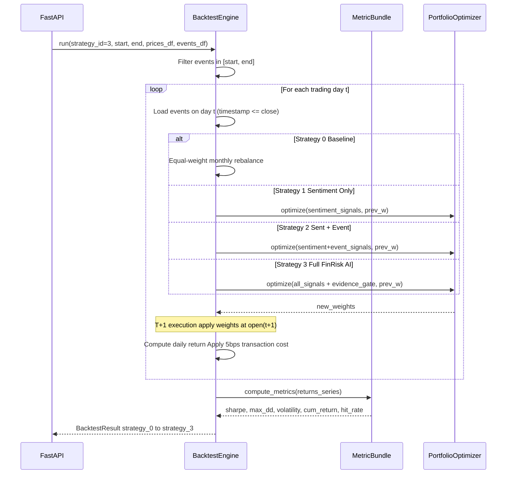

---

### Optimizer — Decision Flow

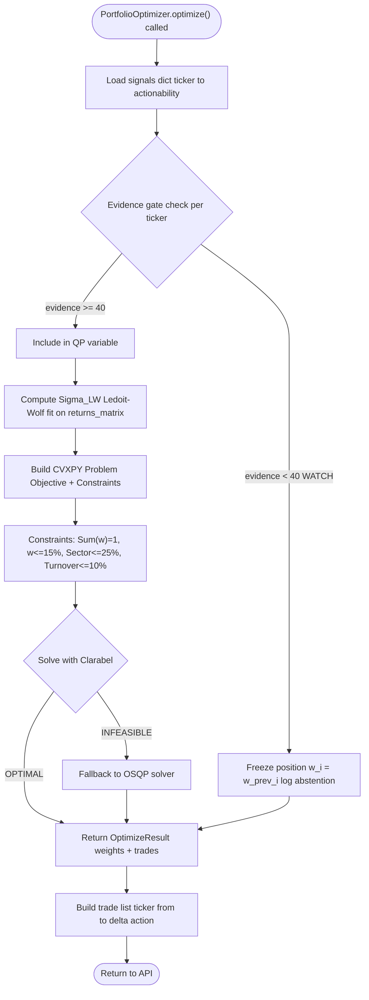

---

### Evidence Gate — State Machine

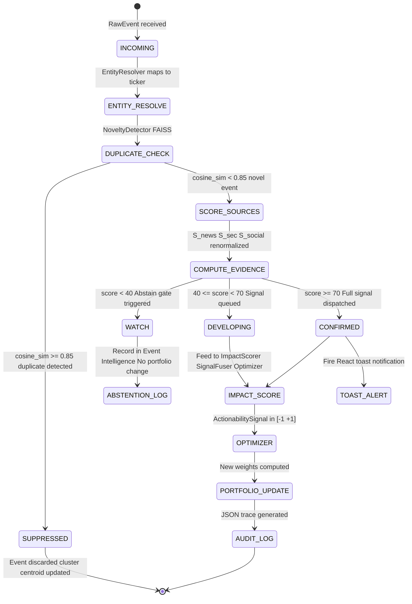

---

## Summary Tables

### HLD Layer Responsibilities

| Layer | Technology | Responsibility | Key SLA |
|:------|:-----------|:---------------|:--------|
| **L1 — Ingestion** | Python requests, CSV | GDELT + SEC EDGAR polling, local cache, retry | ~15 min freshness |
| **L2 — NLP** | PyTorch, FAISS, HuggingFace | Entity resolution, dedup, sentiment, classification, evidence gate | < 50ms per event |
| **L3 — Risk Engine** | CVXPY, NumPy, Scikit-Learn | Signal fusion, QP optimization, macro stress simulation | < 150ms per optimize |
| **L4 — API Gateway** | FastAPI, Uvicorn | Async REST, 60s result cache, LLM narrative endpoint | < 200ms p95 |
| **L5 — Dashboard** | React 18, Vite, Recharts | Live/Demo UI, 5 tabs, toast alerts, offline fallback | Instant (demo data) |

### LLD Key Design Decisions

| Component | Choice | Rationale |
|:----------|:-------|:----------|
| Embedding model | all-MiniLM-L6-v2 (384d) | 5x faster than FinBERT; sufficient for deduplication |
| Vector index | FAISS IndexFlatIP | Zero infrastructure dependency, sub-5ms local search |
| Covariance estimator | Ledoit-Wolf shrinkage | Numerically stable for N=15 stocks, T=504 days |
| QP solver | CVXPY + Clarabel to OSQP fallback | Constraint-first formulation, deterministic solve |
| Frontend state | React hooks only | Sufficient at this scale, zero added dependency |
| LLM integration | Gemini 1.5 Flash + deterministic fallback | Free tier; fallback ensures demo always works |
| Evidence gate threshold | 40 / 70 (Watch / Confirmed) | Calibrated to suppress ~60% of duplicate/unconfirmed noise |

---

*FinRisk AI — Built for the S&P Global & CRISIL Campus Hackathon 2026*
